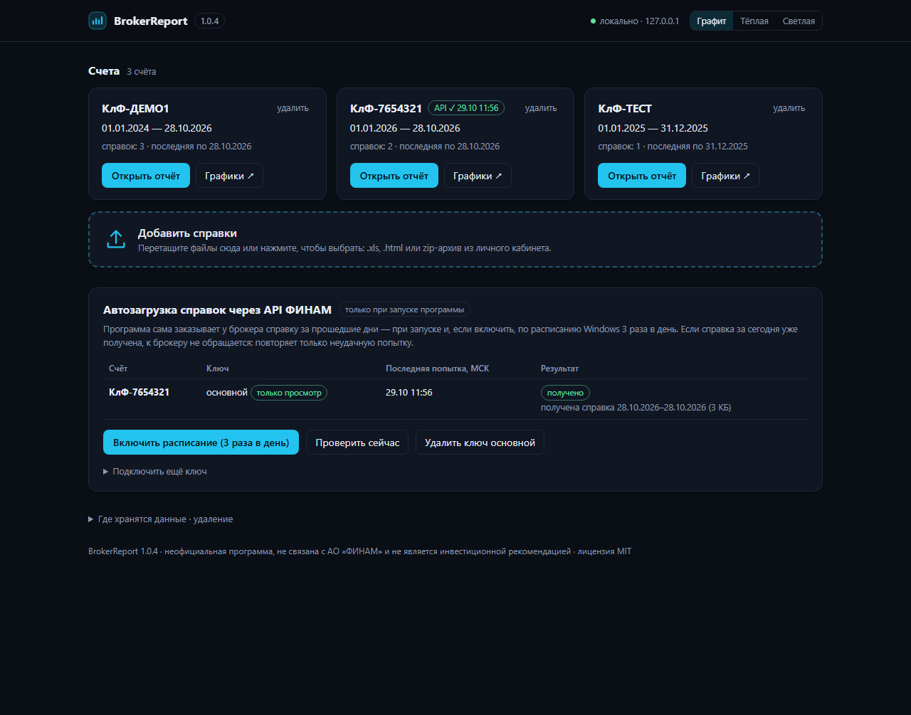
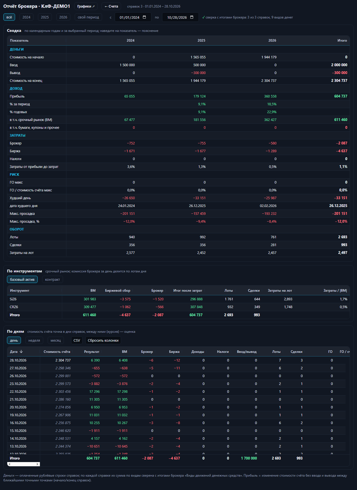
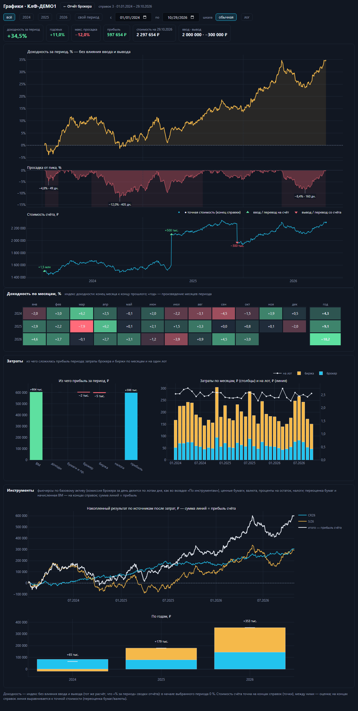

# BrokerReport

[](https://github.com/atosivanovai-creator/broker-report/actions/workflows/ci.yml)
[](LICENSE)


Бесплатная программа для Windows: загружаете «Справки о состоянии обязательств» брокера ФИНАМ — получаете
отчёт по счёту в браузере: сводку по календарным годам (деньги, доход, затраты, риск, оборот), результат по
инструментам срочного рынка, блок «Ценные бумаги» (облигации, акции, фонды — по ISIN), разбивку по дням и окно
графиков (доходность, просадка, стоимость счёта, месяцы, затраты).

Всё считается на вашем компьютере: программа слушает только `127.0.0.1`, справки никуда не отправляются.
В интернет она обращается только к `api.finam.ru` — и только если вы сами подключили ключ Trade API
(автозагрузка справок).

> Неофициальная программа, не связана с АО «ФИНАМ». Не является инвестиционной рекомендацией.



## Возможности

- **Сводка по годам** — стоимость счёта на начало и конец, ввод/вывод (переводы между своими счетами — тоже),
  прибыль и доходность каждого года, ВМ, купоны и дивиденды, затраты брокера и биржи, налоги, ГО, просадка.
- **По инструментам** — сделки, лоты, результат и затраты по каждому фьючерсу.
- **Ценные бумаги** — по каждой бумаге (см. ниже).
- **По дням** и **графики** — индекс доходности, просадка, стоимость счёта, месяцы, затраты.
- **Сверка с брокером** — у каждой справки сумма разобранных строк сверяется с итогами брокера «Виды движений
  денежных средств» до копейки; результат — в строке «сверка с итогами брокера».
- **Автозагрузка через Finam Trade API** — при запуске и по расписанию Windows 3 раза в день; к брокеру
  обращается, только если справки ещё нет и сегодня она ещё не была получена.



Окно «Графики» (кнопка «Графики ↗» у счёта): доходность без влияния ввода и вывода, просадка, стоимость счёта
с отметками ввода и вывода, доходность по месяцам, из чего сложилась прибыль, затраты по месяцам и на лот,
результат по источникам (фьючерсы, ценные бумаги, валюта, проценты на остаток, налоги, прочее; сумма линий =
прибыль счёта). Период выбирается кнопками годов или датами, шкала — обычная или логарифмическая.



Скриншоты сняты на вымышленном счёте «КлФ‑ДЕМО1» (`tests/demo_data.py`), реальных данных в них нет.

## Установка

1. Скачайте `BrokerReport-<версия>-win64.zip` со страницы [Releases](../../releases) и сверьте контрольную
   сумму с `SHA256SUMS.txt` (PowerShell: `Get-FileHash BrokerReport-*.zip`).
2. Распакуйте в любую папку и запустите `BrokerReport.exe` — откроется консольное окно и страница «Счета»
   в браузере. Закройте консольное окно, чтобы остановить программу.
3. Если Windows SmartScreen предупредит о неизвестном издателе: «Подробнее» → «Выполнить в любом случае»
   (программа не подписана сертификатом издателя).

Ключи запуска: `--port 8766` (другой порт), `--no-browser`, `--data D:\папка` (свой каталог данных),
`--no-fetch` (не запрашивать справки при запуске).

## Какие справки нужны

«Справка о состоянии обязательств» из личного кабинета ФИНАМ — файлом `.xls` или `.html` (внутри — HTML),
либо zip-архив из кабинета как есть: вложенные архивы распаковываются, файлы подписи `.sga` пропускаются.

- Счёт и период программа берёт из шапки справки, имена файлов не важны. Несколько счетов — каждый отдельно.
- Лучше справки по календарным годам (текущий год — по сегодняшний день): стоимость счёта известна только
  на концах справок, поэтому одна справка за несколько лет по годам не делится.
- Повторная загрузка справки за тот же период заменяет прежнюю.

## Ценные бумаги

По каждой бумаге (ISIN): количество и оценка брокера (с НКД) на начало и конец периода, куплено, продано,
погашено, купоны и дивиденды, комиссии, результат и проверка количества: начало + куплено − продано −
погашено должно равняться концу. ✓ — сошлось, ⚠ — нет (такой строке не доверяйте). Позиция — как у брокера
в «Оценке обязательств по незавершённым сделкам»: с купленными, но ещё не поставленными бумагами и бумагами,
выданными брокеру в займ. Операции, которые программа не знает, перечисляются под таблицей. Строка «Валюта» —
покупки и продажи валюты.

## Автозагрузка через API ФИНАМ

1. На портале [Finam Trade API](https://api.finam.ru/) → «Токены» создайте ключ и отметьте нужные счета.
   Рекомендуется доступ **«только просмотр»**. Если брокер откажет по нему в справке, программа покажет
   ошибку — в этом случае создайте ключ с правом торговли и подключите его с отметкой «Разрешить торговый ключ»
   (заявок программа не выставляет), а ключ «только просмотр» удалите.
2. На странице «Счета» в блоке «Автозагрузка» вставьте ключ и нажмите «Подключить ключ».
3. По желанию — «Включить расписание»: задача «BrokerReport - справки ФИНАМ» в Планировщике Windows запускает
   `BrokerReportFetch.exe` (без окна) в 07:30, 13:30 и 19:30; если компьютер был выключен — при включении.

Правило запроса: справка заказывается, только если её ещё нет и сегодня она ещё не была получена. Удачная
загрузка ставит отметку «за сегодня получено» — следующие запуски в этот день к брокеру не обращаются.
Неудача (нет связи, справка не собралась, исчерпана квота) отметки не ставит — следующий запуск пробует снова.
Пропуск в несколько дней закрывается одной справкой (до 92 дней — предел API). Брокер даёт 3 заказа справок
в сутки на клиента; программа тратит не больше одного в день на счёт. Справку, которая ещё собирается,
следующий запуск забирает по номеру заказа, без нового заказа. Если справок по счёту нет совсем — загружается
с 1 января текущего года (более раннюю историю удобнее загрузить файлами из кабинета).

Ключ хранится зашифрованным средствами Windows (DPAPI — расшифровать может только ваш пользователь на этом
компьютере) и в окне больше не показывается. Ключ с правом торговли программа принимает только с отметкой
«Разрешить торговый ключ»; заявок она не выставляет и таких функций не содержит. Журнал — `api.log` в папке данных.

## Где данные

`%LOCALAPPDATA%\BrokerReport`: `reports` — загруженные справки, `cache` — кэш разбора, `api.json` —
зашифрованные ключи API, `api-state.json` и `api.log` — состояние и журнал автозагрузки.
Кнопки «удалить» (счёт) и «Удалить все данные» на странице «Счета» стирают их.

## Сборка из исходников

Нужен Python 3.12 (Windows).

```powershell
python -m venv .venv
.venv\Scripts\pip install -r requirements.txt -r requirements-dev.txt
.venv\Scripts\python -m pytest tests
.venv\Scripts\python build.py        # dist\BrokerReport-<версия>-win64.zip
```

Без сборки: `.venv\Scripts\python app.py`. Релизы собираются в GitHub Actions из тега `v*`
(`.github/workflows/release.yml`): архив и `SHA256SUMS.txt` прикладываются к релизу. История изменений —
[CHANGELOG.md](CHANGELOG.md).

## Участие

Ошибки и предложения — в [Issues](../../issues). Перед отправкой справки для разбора ошибки уберите из неё
номер счёта, ФИО и суммы — см. [CONTRIBUTING.md](CONTRIBUTING.md). Уязвимости — по [SECURITY.md](SECURITY.md).

## Лицензия

[MIT](LICENSE). Используемые компоненты (Dash, Plotly, dash-ag-grid / AG Grid Community, Flask, Werkzeug,
waitress, Python и их зависимости) — под свободными лицензиями MIT, BSD, Apache, MPL-2.0 (certifi), ZPL, PSF;
тексты — в `THIRD-PARTY-NOTICES.txt` внутри архива релиза.
